<div align="center">

# Citrus Harvesting Robot

**An open, low-cost, 3D-printed tracked robot platform for selective orange harvesting, built on a layered IoT architecture.**


[](https://doi.org/10.5281/zenodo.24451133)

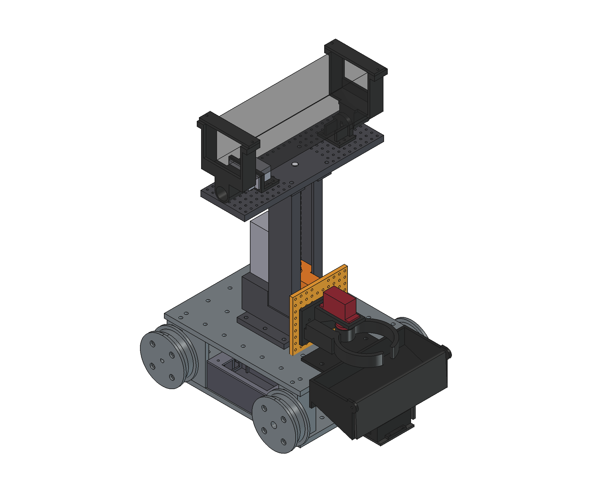

**[Project page](https://ghtassinari.github.io/CitrusHarvestingRobot/) · [Printed parts](#printed-parts) · [Bill of materials](docs/bill-of-materials.md) · [Design log](docs/design-log.md)**

</div>

---

## Table of contents

- [About](#about)
- [Highlights](#highlights)
- [System architecture](#system-architecture)
- [Repository structure](#repository-structure)
- [Printed parts](#printed-parts)
  - [01 · Chassis and locomotion](#01--chassis-and-locomotion)
  - [02 · Power enclosures](#02--power-enclosures)
  - [03 · Lead-screw elevator](#03--lead-screw-elevator)
  - [04 · Kinect v2 tilt mount](#04--kinect-v2-tilt-mount)
  - [05 · Cage gripper](#05--cage-gripper)
  - [06 · Hopper](#06--hopper)
  - [07 · Assembly tools](#07--assembly-tools)
  - [Discontinued part numbers](#discontinued-part-numbers)
- [Printing guidelines](#printing-guidelines)
- [Bill of materials](#bill-of-materials)
- [Assembly](#assembly)
- [Test results](#test-results)
- [Roadmap and proposed improvements](#roadmap-and-proposed-improvements)
- [Academic context and citation](#academic-context-and-citation)
- [Credits](#credits)
- [License](#license)

---

## About

Table oranges are still picked by hand, which is costly and increasingly hard to staff, while trunk and canopy shakers damage the tree and the fruit. This project explores the opposite approach: a small robot that harvests **one fruit at a time**.

This repository contains the **complete mechanical design** of the prototype developed for the undergraduate thesis *"IoT Architecture for Autonomous Orange Harvesting: Automation and Data-Driven Decision Making"* (Bachelor's degree in Information Systems, IFSULDEMINAS – Campus Machado, Brazil, 2026). It includes the FreeCAD source model, every printable STL file used on the robot, assembly guides, a bill of materials and a log of the design iterations.

The platform is meant to be **expandable**: the top plates use a regular hole grid, so new tools and sensors can be bolted on without reprinting any existing part.

> [!NOTE]
> Scope of this release: mechanics and embedded hardware. Fruit detection with computer vision, the integrated harvesting software and field tests are planned as future work (see [Roadmap](#roadmap-and-proposed-improvements)).

## Highlights

| Subsystem | What it does | Key figures |
|---|---|---|
| Tracked chassis | Skid-steering locomotion | Two 248 × 200 mm PETG plates · TPU tracks · 2 × JGY370 12 V 130 RPM worm-gear motors |
| Lead-screw elevator | Moves the gripper vertically | Ø16 mm printed lead screw, 8 mm lead, steel M8 core · 40 RPM motor → ~320 mm/min · ~131 mm usable stroke |
| Kinect v2 mount | Points the depth camera up/down | DS3218MG 20 kg·cm servo · −15° to +20° collision-free tilt |
| Cage gripper | Encloses and detaches the fruit by pulling | Ø72 mm inner ring · 0–75° opening · single DS3218MG servo |
| Hopper | Stores two oranges and releases them | ~19° ramp · gravity door locked by a 12 V fail-secure solenoid |
| Electronics | Edge computing + real-time control | Raspberry Pi 4 (8 GB) · Arduino Mega 2560 · 3 × BTS7960 · LiPo 3S 5000 mAh |

## System architecture

The hardware follows a four-layer IoT model (perception, network, processing and application). Heavy work, such as image processing, runs on the Raspberry Pi on board the robot (edge computing). Real-time work, such as PWM generation and the solenoid relay, runs on the Arduino. The two boards talk over a single USB cable (serial, PySerial on the Pi side).

<div align="center">
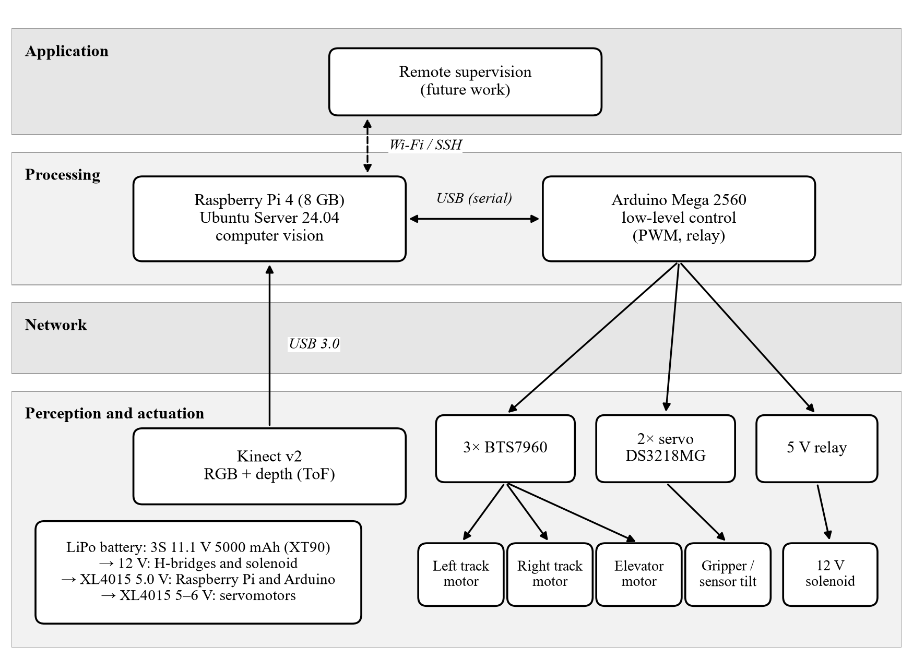
</div>

**Power** comes from a single LiPo 3S battery (11.1 V, 5000 mAh, XT90 connector, which doubles as the main switch), split into isolated branches so that servo and motor current peaks do not reset the control electronics:

| Branch | Source | Loads |
|---|---|---|
| 12 V (battery) | Direct, through terminal blocks | 3 × BTS7960 H-bridges (tracks and elevator), solenoid |
| 5.0 V "clean" | XL4015 step-down #1 | Raspberry Pi 4, Arduino Mega 2560 |
| 5–6 V "muscle" | XL4015 step-down #2 | Servomotors |

All branches share a common ground.

## Repository structure

```
CitrusHarvestingRobot/
├── cad/
│   └── CitrusHarvestingRobot.FCStd   # full FreeCAD assembly (source of truth)
├── stl/
│   ├── 01-chassis/                   # plates, brackets, wheels, tracks, spacers
│   ├── 02-power/                     # battery and charger enclosures
│   ├── 03-elevator/                  # tower, carriage, lead screw, gears
│   ├── 04-kinect-mount/              # tilt cradles and mounts
│   ├── 05-gripper/                   # cage gripper
│   ├── 06-hopper/                    # hopper with solenoid-locked door
│   └── 07-tools/                     # printed tools that make assembly possible
├── docs/
│   ├── assembly-elevator.md
│   ├── assembly-kinect-mount.md
│   ├── bill-of-materials.md
│   └── design-log.md                 # problems found and how they were solved
└── images/                           # renders, diagram and part thumbnails
```

Part numbers (`01`–`37`) are kept from the original project so that every file can be traced back to the design log. Gaps in the numbering are [discontinued parts](#discontinued-part-numbers).

> [!TIP]
> The CAD file is the source of truth: every revision was first applied to the model and checked for interference before being printed. Object names inside the `.FCStd` are in Portuguese; the **CAD object** column in the tables below gives the matching name.

## Printed parts

All parts are printed in **PETG** unless stated otherwise. *Size* is the bounding box of the STL as exported (mm). Every part is fixed with **M3 or M5 screws and nuts**; nothing is glued or press-fitted.

### 01 · Chassis and locomotion

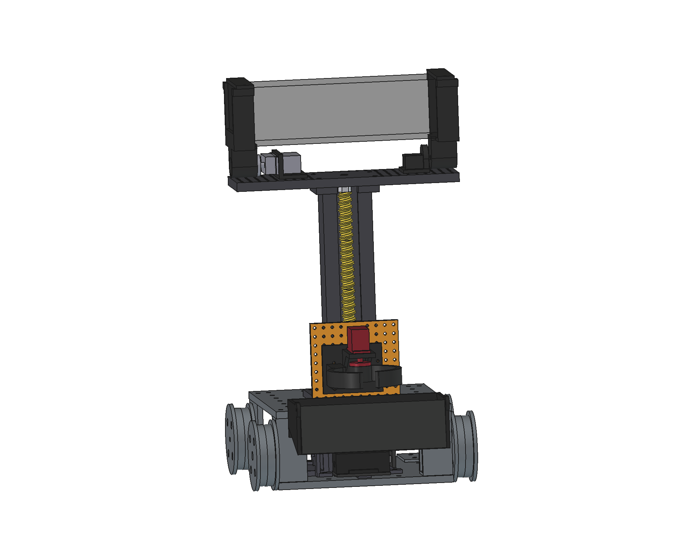

The chassis is a sandwich of two identical plates joined by four side brackets. The plates carry a regular grid of Ø5.5 mm holes, and **no new holes were ever drilled**: every later part was designed around the existing grid. Steering is skid-steer (no steering axle; turning comes from the speed difference between the tracks).

| # | File | CAD object | Qty | Size (mm) | Description |
|---|---|---|:-:|---|---|
| 01 | [`01_TopPlate.stl`](stl/01-chassis/01_TopPlate.stl) | `PlacaSuperior` | 1 | 248 × 200 × 8 | Upper deck. Carries the elevator tower, the gripper and the hopper bracket. |
| 02 | [`02_BottomPlate.stl`](stl/01-chassis/02_BottomPlate.stl) | `PlacaInferior` | 1 | 248 × 200 × 8 | Lower deck. Carries the battery and charger enclosures. Same hole grid as the top plate. |
| 03 | [`03_MotorBracket_Left.stl`](stl/01-chassis/03_MotorBracket_Left.stl) | `SuporteMotor_Esq` | 1 | 70 × 34 × 73 | U-shaped bracket for the left drive motor. The motor body sits inside the chassis and the M6 output shaft exits through a pocket for an MR126ZZ bearing. |
| 04 | [`04_MotorBracket_Right.stl`](stl/01-chassis/04_MotorBracket_Right.stl) | `SuporteMotor_Dir` | 1 | 70 × 34 × 73 | Mirror of part 03. |
| 05 | [`05_BearingBracket_Left.stl`](stl/01-chassis/05_BearingBracket_Left.stl) | `SuporteRolamento_Esq` | 1 | 34 × 34 × 73 | Rear bracket with a pocket for a 6000ZZ bearing (M10 axle). The axle is off-centre (30 mm from the base): **mount it upright on the correct side**, otherwise the rear wheel ends up 13 mm higher. |
| 06 | [`06_BearingBracket_Right.stl`](stl/01-chassis/06_BearingBracket_Right.stl) | `SuporteRolamento_Dir` | 1 | 34 × 34 × 73 | Mirror of part 05. |
| 07 | [`07_FrontWheel_Half.stl`](stl/01-chassis/07_FrontWheel_Half.stl) | `RodaFrontal_Metade` | **4** | 80 × 13 × 80 | Half of a drive wheel (two halves per wheel, joined by 4 × M4). Ø6.3 mm bore for the motor's M6 shaft and a radial hole for an optional M3 × 16 self-tapping locking screw. |
| 08 | [`08_RearWheel_Half.stl`](stl/01-chassis/08_RearWheel_Half.stl) | `RodaTraseira_Metade` | **4** | 80 × 80 × 13 | Half of an idler wheel (two halves per wheel, 4 × M4) on the M10 axle. |
| 09 | [`09_Track_Left.stl`](stl/01-chassis/09_Track_Left.stl) | `Esteira_Esq` | 1 | Ø204.4 × 17 | **TPU** track ring with teeth on the inner face. |
| 10 | [`10_Track_Right.stl`](stl/01-chassis/10_Track_Right.stl) | `Esteira_Dir` | 1 | Ø204.4 × 17 | **TPU**, same as part 09. |
| 13 | [`13_RearAxleSpacer.stl`](stl/01-chassis/13_RearAxleSpacer.stl) | `EspacadorRolamento` | 2 | Ø16 × 8 | Spacer between the 6000ZZ bearing and the rear wheel. |
| 15 | [`15_FrontAxleSpacer.stl`](stl/01-chassis/15_FrontAxleSpacer.stl) | `EspacadorRolamentoMotor` | 2 | Ø12 × 8 | Spacer between the MR126ZZ bearing and the front wheel. |

<details>
<summary>Thumbnails</summary>

| | | | |
|:-:|:-:|:-:|:-:|
| 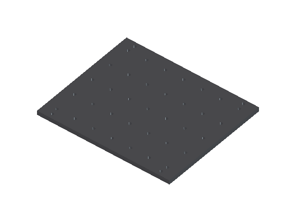<br>01 | 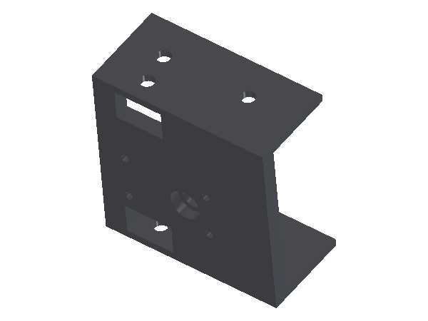<br>03 / 04 | 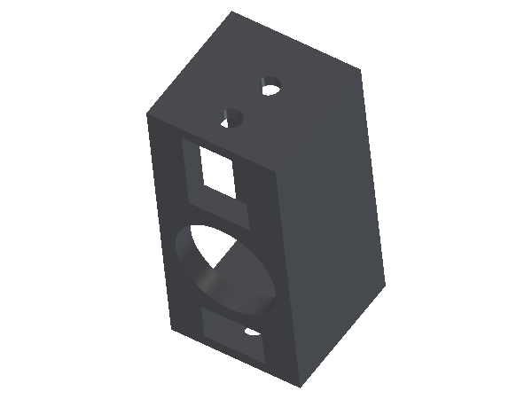<br>05 / 06 | 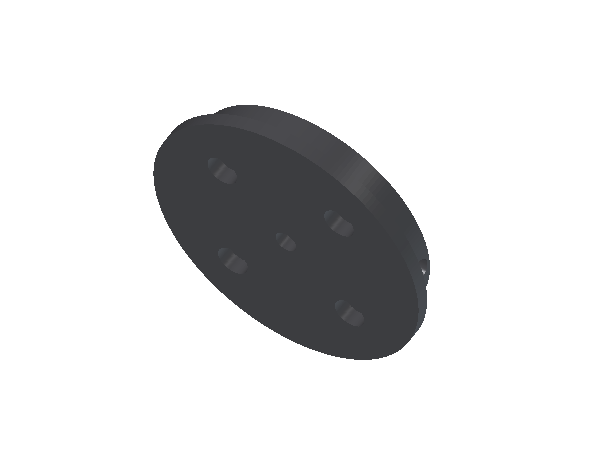<br>07 |
| 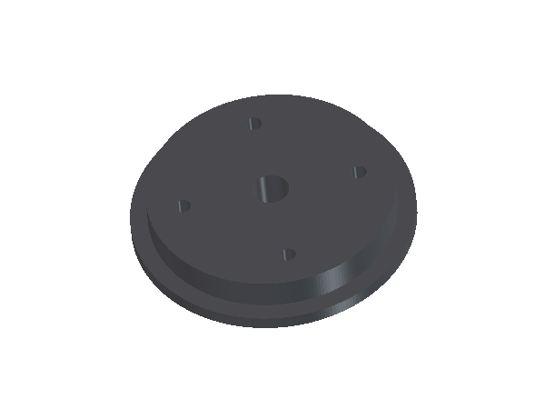<br>08 | 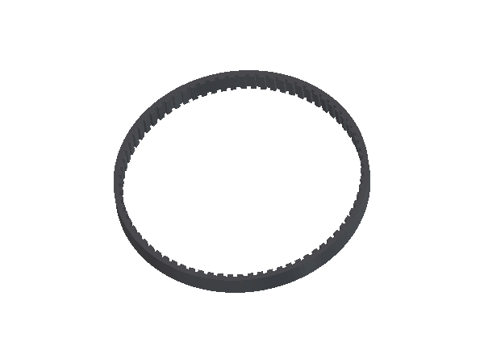<br>09 / 10 | 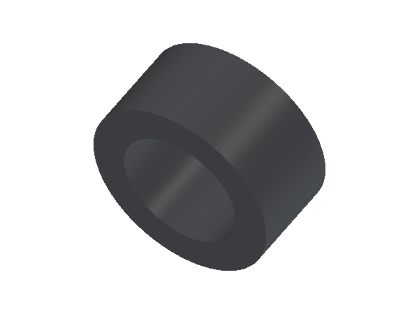<br>13 | 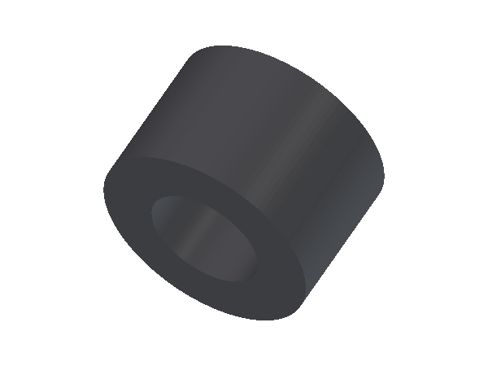<br>15 |

</details>

> [!WARNING]
> **Track length.** The track that ran successfully on the prototype was printed at **92 %** of the installed perimeter. The file in this repository is the later **97 %** revision with the teeth moved to the inner face, which has not been printed yet. If it turns out too loose, regenerate the ring at 92 % from the CAD file (scaling the STL in the slicer also changes the tooth pitch).

**Axle stack-ups** (inside to outside):

- **Front (drive):** motor bracket → MR126ZZ bearing → M6 washer → spacer 15 → front wheel → M6 washer → M6 nyloc nut.
- **Rear (idler):** bearing bracket → 6000ZZ bearing → M10 washer → spacer 13 → rear wheel → M10 washer → M10 thin nut + M10 nyloc nut, with medium-strength threadlocker.

### 02 · Power enclosures

The space under the bottom plate is only ~3 mm above the ground, so the battery and charger sit **on top of** the bottom plate, bolted to existing holes.

| # | File | CAD object | Qty | Size (mm) | Description |
|---|---|---|:-:|---|---|
| 16 | [`16_BatteryBox.stl`](stl/02-power/16_BatteryBox.stl) | `CaixaBateria` | 1 | 224 × 77.5 × 32 | Holds the 147 × 51 × 27 mm LiPo, centred. M5 tabs to the plate; full-height cable cut-outs at the back. |
| 17 | [`17_BatteryBox_Lid.stl`](stl/02-power/17_BatteryBox_Lid.stl) | `CaixaBateria_Tampa` | 1 | 170 × 74 × 17 | Lid fixed by horizontal M3 × 20 screws through side fins (nut on the far side of the fin). Prints upside down without support. |
| 18 | [`18_ChargerBox.stl`](stl/02-power/18_ChargerBox.stl) | `CaixaCarregador` | 1 | 154.7 × 65.5 × 40.5 | Holds the iMAX B3 Pro charger lying flat with the LEDs up. Back open for the balance lead, front open for the mains plug. |
| 19 | [`19_ChargerBox_Lid.stl`](stl/02-power/19_ChargerBox_Lid.stl) | `CaixaCarregador_Tampa` | 1 | 138.5 × 63.5 × 16.5 | Lid with a window over the LEDs. |
| 22 | [`22_PlugHolder.stl`](stl/02-power/22_PlugHolder.stl) | `PortaPlugue` | 1 | 16 × 51.5 × 15 | Parking block for the charger's two-pin plug (Ø4.2 mm through holes, 19 mm apart), screwed to the charger lid. |

<details>
<summary>Thumbnails</summary>

| | | | |
|:-:|:-:|:-:|:-:|
| 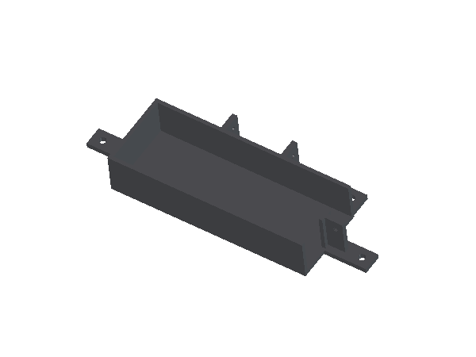<br>16 | 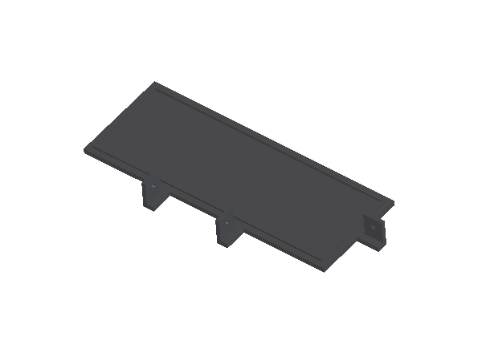<br>17 | 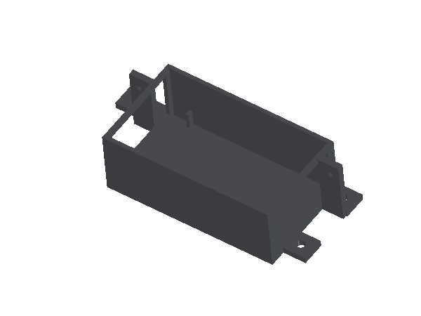<br>18 | 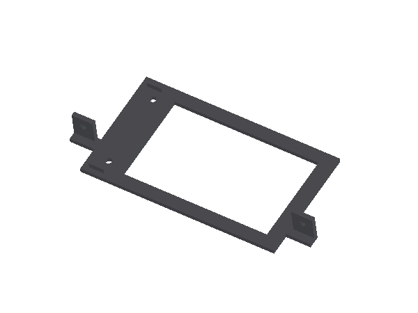<br>19 |

</details>

### 03 · Lead-screw elevator

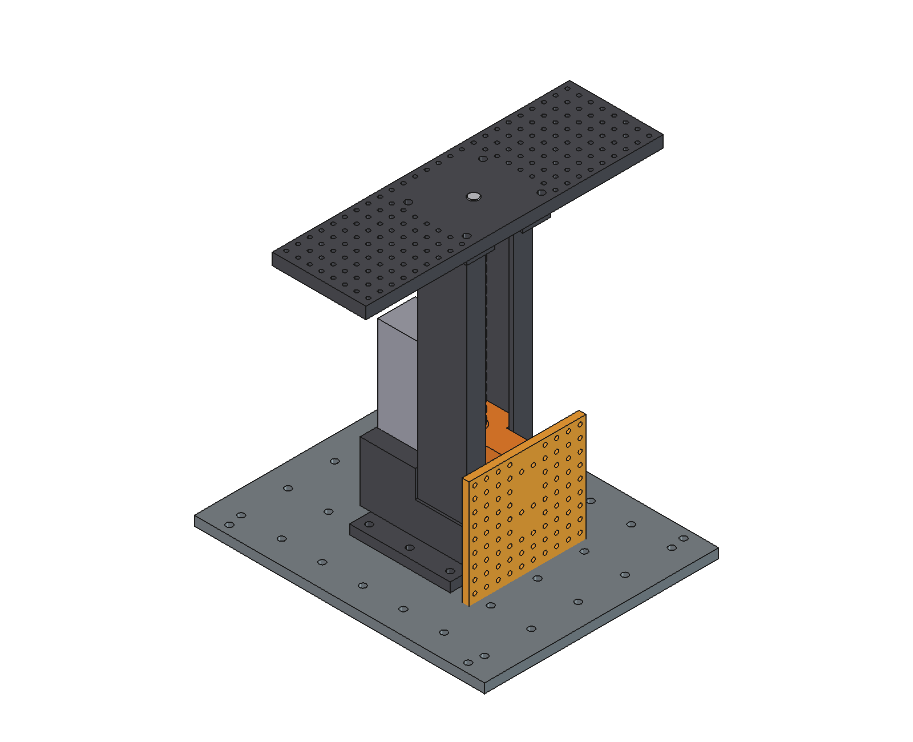

A tower in the centre of the top plate houses a printed lead screw built around a steel M8 threaded rod. The rod ends turn in two 608ZZ bearings. A JGY370 12 V 40 RPM worm-gear motor drives the screw through a 1:1 pair of 26-tooth, module 1.5 gears. The carriage rides the screw and carries the tool plate.

- Theoretical speed: 40 RPM × 8 mm = **320 mm/min (~5.3 mm/s)**.
- Total stroke ~149 mm; **usable stroke ~131 mm** (in the last ~18 mm at the bottom the tool plate would touch the top plate).
- Helix angle ≈ 10°: the screw is self-locking only if the PETG-on-PETG friction coefficient exceeds ~0.18 (not measured). The worm-gear motor adds holding resistance.

| # | File | CAD object | Qty | Size (mm) | Description |
|---|---|---|:-:|---|---|
| 24 | [`24_ElevatorTower.stl`](stl/03-elevator/24_ElevatorTower.stl) | `Elevador_Torre` | 1 | 97 × 96 × 245 | Single-piece tower: motor shelf, gear chamber with the lower 608ZZ seat, guide slot for the carriage and four top lugs. Fixed with 6 × M5 × 20. Fits the 256 mm build height. |
| 25 | [`25_TopPlate_Kinect.stl`](stl/03-elevator/25_TopPlate_Kinect.stl) | `Kinect_Placa` | 1 | 254 × 80 × 10 (exported at 45°) | Plate on top of the tower: upper 608ZZ seat, 4 × M5 to the lugs and an M3 grid (10 mm pitch, 151 holes) for the Kinect mount. |
| 26 | [`26_ToolPlate.stl`](stl/03-elevator/26_ToolPlate.stl) | `Elevador_PlacaFerramentas` | 1 | 110 × 100 × 6 | Expandable tool plate with an M3 grid (10 mm pitch). The gripper bolts here. |
| 27 | [`27_Carriage.stl`](stl/03-elevator/27_Carriage.stl) | `Elevador_Carro` | 1 | 55 × 46 × 50 | Carriage with internal thread (0.5 mm radial clearance) and a tongue for the tool plate (4 × M3 × 20). |
| 28 | [`28_LeadScrew.stl`](stl/03-elevator/28_LeadScrew.stl) | `Elevador_Fuso` | 1 | Ø16 × 215.5 | Single-start lead screw, 8 mm lead, 45° flanks (prints upright with no support), hexagonal drive at the bottom. Slides over the M8 rod. |
| 30 | [`30_LeadScrewGear.stl`](stl/03-elevator/30_LeadScrewGear.stl) | `Elevador_Engrenagem` | 1 | Ø41.8 × 17.9 | 26 T, m 1.5 gear with 16 mm wide teeth (meshes with the pinion anywhere 2–18 mm above the floor) and a hex pocket for the M8 nut and the screw's hex drive. |
| 31 | [`31_Pinion.stl`](stl/03-elevator/31_Pinion.stl) | `Elevador_Pinhao` | 1 | Ø41.7 × 8 | 26 T, m 1.5 pinion on the motor's M6 shaft (M6 nut on top, M6 nyloc below). |

<details>
<summary>Thumbnails</summary>

| | | | |
|:-:|:-:|:-:|:-:|
| 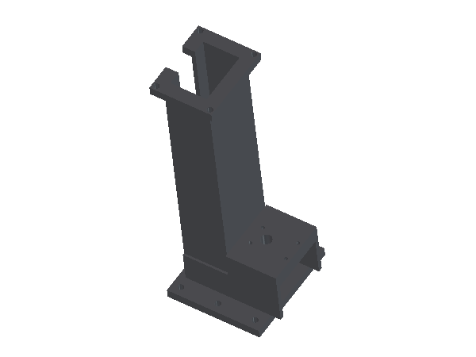<br>24 | 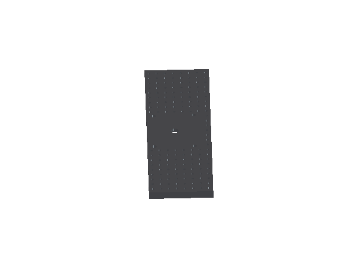<br>25 | 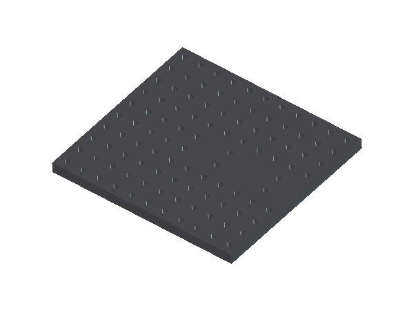<br>26 | 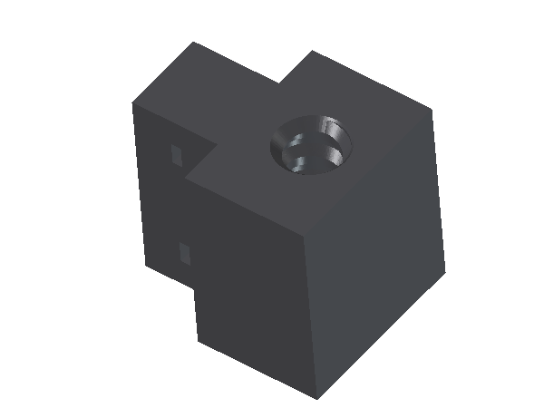<br>27 |
| 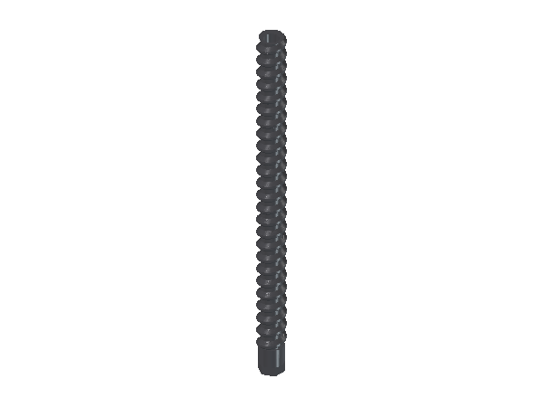<br>28 | 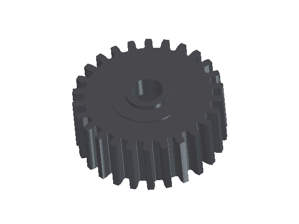<br>30 | 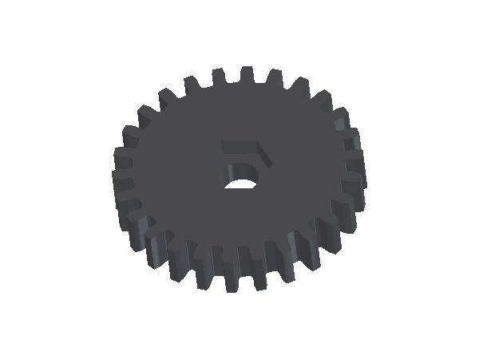<br>31 | |

</details>

Step-by-step guide: [docs/assembly-elevator.md](docs/assembly-elevator.md).

### 04 · Kinect v2 tilt mount

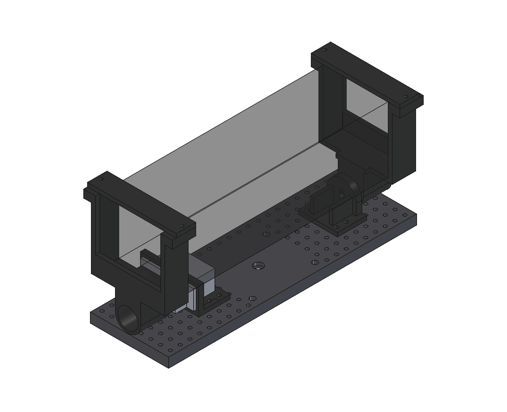

The Kinect v2 (Xbox One version, no stand) rests in two cradles, one at each end. One cradle is driven by a DS3218MG servo and the other turns freely on an M5 pivot, so the ~1 kg sensor load is shared. The tilt axis lies under the sensor, and nothing overhangs the sensor's ends.

| # | File | CAD object | Qty | Size (mm) | Description |
|---|---|---|:-:|---|---|
| 35a | [`35a_KinectCradle_Servo.stl`](stl/04-kinect-mount/35a_KinectCradle_Servo.stl) | `Kinect_Berco_Servo` | 1 | 91 × 105 × 29 | U-cradle bolted to the round servo horn (4 screws on a 7 mm radius). Prints lying on its side, no support. |
| 35b | [`35b_KinectCradle_Pivot.stl`](stl/04-kinect-mount/35b_KinectCradle_Pivot.stl) | `Kinect_Berco_Pivo` | 1 | 91 × 105 × 29 | U-cradle with a hex socket that captures the head of an M5 × 20 hex bolt (the pivot pin). |
| 35c | [`35c_KinectClampBar.stl`](stl/04-kinect-mount/35c_KinectClampBar.stl) | `Kinect_Barra_1/2` | **2** | 91 × 20 × 4 | Clamp bars that hold the sensor in the cradles (2 × M3 × 20 each). |
| 35d | [`35d_ServoMount.stl`](stl/04-kinect-mount/35d_ServoMount.stl) | `Kinect_Suporte_Servo` | 1 | 60 × 32 × 28 | Wall with a 41 × 21 mm window for the servo body; 4 × M3 to the plate, 4 × M3 on the servo tabs. |
| 35e | [`35e_PivotMount.stl`](stl/04-kinect-mount/35e_PivotMount.stl) | `Kinect_Suporte_Pivo` | 1 | 40 × 30 × 30 | Pivot wall with a Ø5.6 mm hole and a 16 mm gap behind it for the M5 nyloc nut. |

<details>
<summary>Thumbnails</summary>

| | | | | |
|:-:|:-:|:-:|:-:|:-:|
| 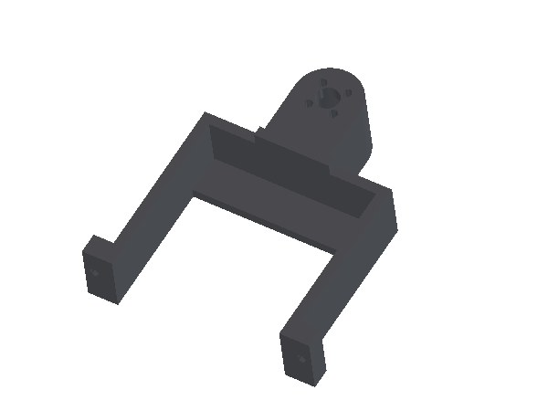<br>35a | 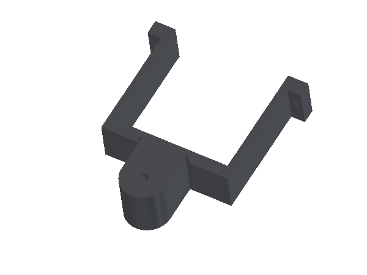<br>35b | 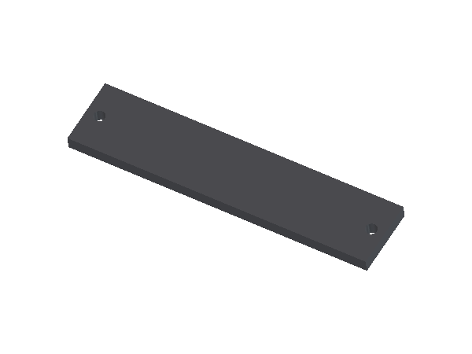<br>35c | 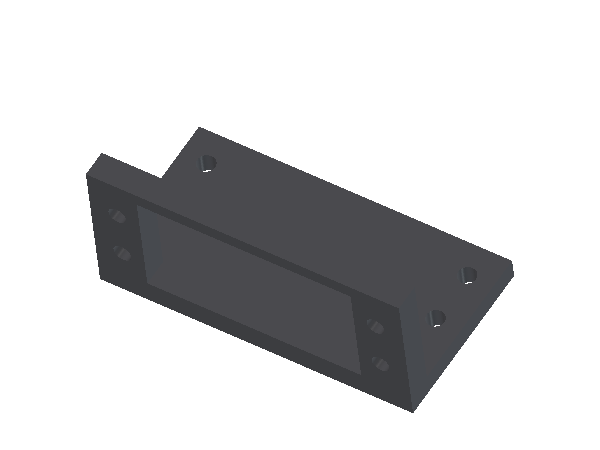<br>35d | 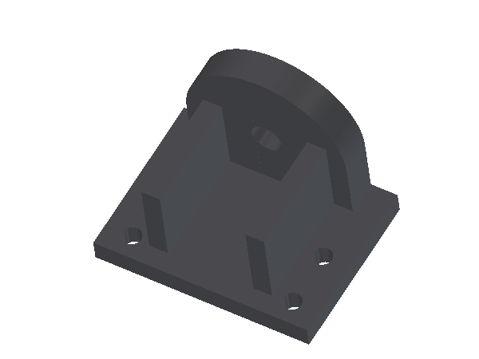<br>35e |

</details>

Step-by-step guide: [docs/assembly-kinect-mount.md](docs/assembly-kinect-mount.md).

### 05 · Cage gripper

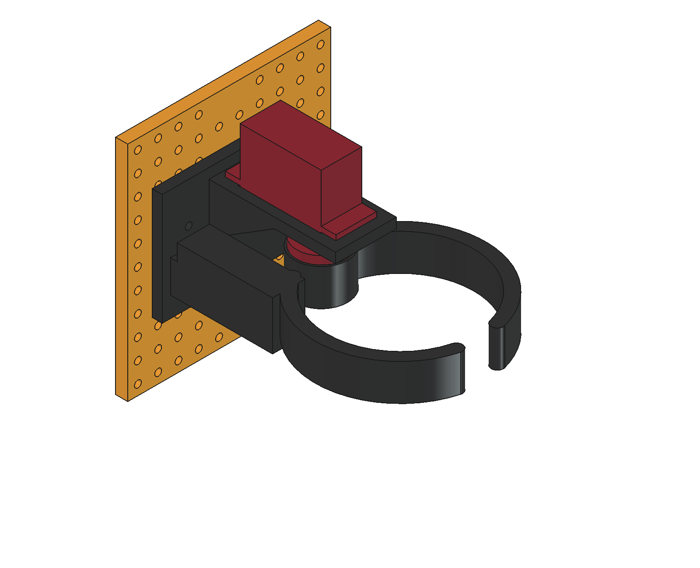

Two arc-shaped jaws close into a ring that is **smaller than an orange**, so the fruit cannot slip out. Detachment is done by **pulling**: with the fruit enclosed, the elevator lowers or the robot backs up (pull + bend). This needs no extra actuator. Stem cutting and twisting are on the [roadmap](#roadmap-and-proposed-improvements).

| # | File | CAD object | Qty | Size (mm) | Description |
|---|---|---|:-:|---|---|
| 36A | [`36A_GripperMount_FixedJaw.stl`](stl/05-gripper/36A_GripperMount_FixedJaw.stl) | `Garra_Suporte` | 1 | 55 × 72 × 125 | Flange bolted to the tool plate (4 × M3 × 15 + nuts), shelf with a 41 × 21 mm window where the DS3218MG drops in from above (4 × M3 + nuts), and an arm ending in the **fixed jaw**. Revision v2: the fixed jaw was raised 8 mm to match the real servo (see [design log](docs/design-log.md)). |
| 36B | [`36B_MovingJaw.stl`](stl/05-gripper/36B_MovingJaw.stl) | `Garra_Mandibula` | 1 | 92.7 × 55 × 18 | Moving jaw screwed to the round servo horn (4 × Ø3.4 mm holes on a 7 mm radius, Ø21 mm recess, centre hole for the horn screw). |

- Closed ring: Ø72 mm inside, ~14 mm front gap.
- Opening: 0–85° collision-free in CAD; use **0–75°** in firmware.
- Everything stays above the lower edge of the tool plate, so the gripper never hits the chassis.

<details>
<summary>Thumbnails</summary>

| | |
|:-:|:-:|
| 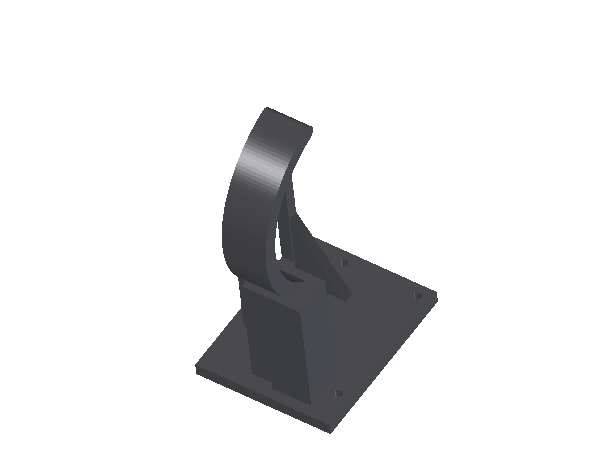<br>36A | 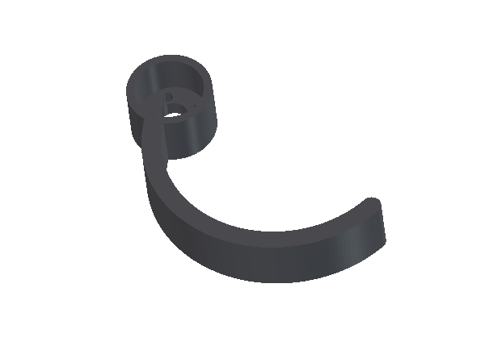<br>36B |

</details>

### 06 · Hopper

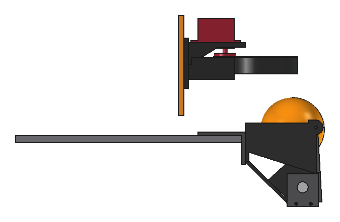

A static hopper hangs from the front edge of the top plate, below the gripper. It holds two oranges side by side. A ~19° ramp rolls them to a door hinged at the top and leaning slightly outwards, so it swings shut by its own weight. A 12 V **fail-secure** solenoid (TAU-S0837DL, locked when unpowered) engages a slot in a fin under the door.

**Release cycle:** the Arduino counts the fruits dropped by the gripper. After the second one, it energises the solenoid for ~3 s through a relay. The pin retracts, the oranges push the door open and roll out, and the door falls back and relocks.

| # | File | CAD object | Qty | Size (mm) | Description |
|---|---|---|:-:|---|---|
| 37a | [`37a_HopperBracket.stl`](stl/06-hopper/37a_HopperBracket.stl) | `Moega_Suporte` | 1 | 52 × 100 × 36 | L-bracket: base on the top plate (2 × M5 in existing holes), flange against the hopper's back wall (3 × M3 × 15). |
| 37b | [`37b_HopperBody.stl`](stl/06-hopper/37b_HopperBody.stl) | `Moega` | 1 | 82.5 × 174 × 87 | Body with the ramp and a 55 × 26 × 20.5 mm pocket for the solenoid under the end of the ramp. |
| 37c | [`37c_HopperDoor.stl`](stl/06-hopper/37c_HopperDoor.stl) | `Moega_Porta` | 1 | 74.7 × 165 × 26.4 | Door hung from two M3 × 15 screws through the wall lugs. The bottom fin has a 10 × 8 mm slot for the solenoid pin. Opens 0–90°. |
| 37d | [`37d_SolenoidCover.stl`](stl/06-hopper/37d_SolenoidCover.stl) | `Moega_Tampa` | 1 | 44 × 61 × 3 | 3 mm cover for the solenoid pocket (4 × M3 + nuts). |

Operating constraints: the gripper must be ~25 mm above the lowest point of its stroke to drop a fruit into the hopper. The door sits ~55 mm above the ground, so the collecting crate must be low.

<details>
<summary>Thumbnails</summary>

| | | | |
|:-:|:-:|:-:|:-:|
| 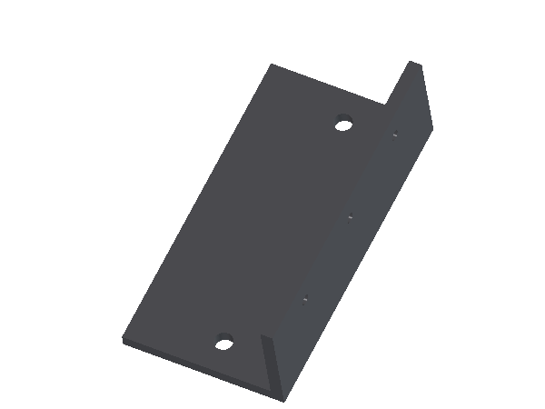<br>37a | 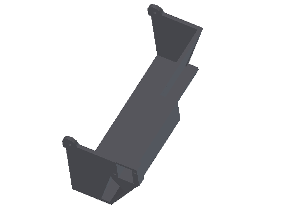<br>37b | 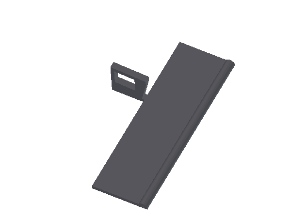<br>37c | 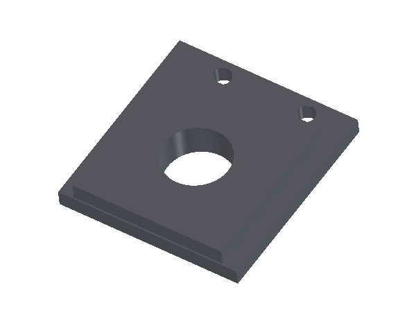<br>37d |

</details>

### 07 · Assembly tools

Some nuts and screws are unreachable with fingers or standard tools once the robot is assembled. These printed tools solve that.

| # | File | CAD object | Qty | Size (mm) | Description |
|---|---|---|:-:|---|---|
| 23 | [`23_NutHolderTool.stl`](stl/07-tools/23_NutHolderTool.stl) | `FerramentaPorca` | 1 | 286 × 13 × 5.5 (exported at 45°) | Long stick with an open M5 nut pocket. It slides in under the top plate and holds the nut below 6 hard-to-reach holes. Side notches show when the nut is aligned. |
| 32 | [`32_ScrewdriverKnob_D3..D6.stl`](stl/07-tools/) | `Ferramenta_CaboChave` | 1 | Ø23.8 × 7 | Knob for a bare screwdriver bit; four bore sizes (Ø3–Ø6 mm). |
| 33 | [`33_LongScrewdriverHandle.stl`](stl/07-tools/33_LongScrewdriverHandle.stl) | `Ferramenta_CaboLongo` | 1 | 110 × 10 × 6.2 | Straight handle for a Ø3 mm steel shaft, used to reach the motor's M3 screws under the elevator shelf. |
| 34 | [`34_Wrench_10mm.stl`](stl/07-tools/34_Wrench_10mm.stl) | `Ferramenta_ChaveBoca10` | 1 | 103.2 × 21 × 3.5 | Thin 10 mm open-end wrench for the M6 nyloc nut under the pinion. |

### Discontinued part numbers

These numbers appear in the design log but were removed from the robot, so they are not included:

| # | Part | Why it was dropped |
|---|---|---|
| 11, 12, 14 | Shaft coupler, wheel lock and coupler bearing support | The motors were replaced by a version with an M6 threaded output shaft, so the wheel mounts directly. |
| 20, 21 | Cable box and sliding door | The mains cable now hangs from the charger lid (part 22). |
| 28a, 28b, 29a, 29b | Lead screw in four pieces | The joints slipped against each other at the end of travel and were replaced by the one-piece screw (part 28). |
| old 36a–36d | First gripper generation (with stem cutter) | Hard to print and it would hit the top plate when lowered. Replaced by parts 36A/36B. |

## Printing guidelines

- **Printer:** Bambu Lab A1 (256 × 256 × 256 mm). The tallest parts (tower 24, lead screw 28) were designed to fit the build height in one piece.
- **Material:** PETG for structural parts; **TPU** (95A) for the tracks (09, 10).
- **Orientation:** the STLs are already exported in printing orientation. Parts 25 and 23 are rotated 45° to fit the bed.
- **Supports:** none, except
  - `36A`: tree supports only under the tip of the fixed jaw;
  - `37b`: back wall on the bed, tree supports only under the solenoid pocket.
- **Lead screw (28):** print upright, one part per plate, with a brim and dry filament to avoid stringing on the thread.
- **Why PETG and screws:** FDM printing reduces the strength of PETG, especially between layers, so parts are oriented with loads parallel to the layers. Every joint uses screws and nuts, never glue or press fits, so any part can be replaced.

## Bill of materials

The full list of electronics, motors, bearings and fasteners per subsystem is in **[docs/bill-of-materials.md](docs/bill-of-materials.md)**. Main components:

| Component | Qty | Role |
|---|:-:|---|
| Raspberry Pi 4 Model B 8 GB (Ubuntu Server 24.04 LTS) | 1 | Edge computer, computer vision |
| Arduino Mega 2560 | 1 | Low-level control (PWM, relay) |
| Microsoft Kinect v2 (Xbox One) + adapter | 1 | RGB + time-of-flight depth camera |
| JGY370 12 V 130 RPM worm-gear motor, M6 threaded shaft | 2 | Tracks |
| JGY370 12 V 40 RPM worm-gear motor, M6 threaded shaft | 1 | Elevator |
| BTS7960 (IBT-2) 43 A H-bridge | 3 | Motor drivers |
| DS3218MG 20 kg·cm servo | 2 | Gripper and Kinect tilt |
| TAU-S0837DL 12 V fail-secure solenoid lock + 5 V relay module | 1 | Hopper door |
| LiPo 3S 11.1 V 5000 mAh, XT90 | 1 | Battery |
| XL4015 5 A step-down converter | 2 | 5.0 V logic and 5–6 V servo rails |
| iMAX B3 Pro balance charger | 1 | On-board charging |

## Assembly

1. **Chassis:** bolt the four side brackets between the plates (M5), install the wheels following the [axle stack-ups](#01--chassis-and-locomotion), then fit the tracks. Make sure all four wheels sit at the same height before testing.
2. **Power:** mount the battery and charger enclosures on the bottom plate, then wire the terminal blocks and the two XL4015 converters.
3. **Elevator:** [docs/assembly-elevator.md](docs/assembly-elevator.md).
4. **Kinect mount:** [docs/assembly-kinect-mount.md](docs/assembly-kinect-mount.md). Centre the servo (`servo.write(90)`) before attaching the cradle.
5. **Gripper:** drop the servo into 36A, bolt 36A to the tool plate, centre the servo and fix the moving jaw (36B) to the horn in the closed position.
6. **Hopper:** fit the solenoid in 37b and close it with 37d, hang the door 37c, then bolt 37b to the bracket 37a and the bracket to the top plate.

> [!CAUTION]
> Until limit switches are installed, never run the elevator motor for more than 1–2 s at a time near the ends of the stroke. The carriage will jam against the bottom collar or the top nut.

## Test results

Bench tests on a firm indoor floor:

| Subsystem | Acceptance criterion | Result |
|---|---|---|
| Chassis | Tracks turn without jamming or jumping off the wheels | ✅ Straight-line driving on a firm floor. Reverse, turns and driving with load still to be evaluated in longer tests. |
| Elevator | Carriage travels the usable stroke without jamming | ✅ ~131 mm stroke. ⚠️ Limit switches still needed. |
| Kinect mount | Tilt −15° to +20° without collision | ✅ Assembled and tilting. |
| Gripper | Opens and closes 0–75° and encloses the fruit | ✅ Works after the 8 mm fixed-jaw correction. |
| Hopper | Door opens with the solenoid and relocks | 🔧 Verified in CAD (0–90° door swing). Physical test pending. |

What went wrong along the way, and how each problem was solved, is documented in **[docs/design-log.md](docs/design-log.md)**.

## Roadmap and proposed improvements

**Mechanical improvements for the next prototype**

- [ ] Limit switches at both ends of the elevator, read by the Arduino.
- [ ] Metal T8 trapezoidal lead screw with a brass nut, for more precision, a longer stroke and a known self-locking behaviour.
- [ ] Stem cutting with a bypass-type blade (stainless steel) passing a fixed counter-blade on the jaw, leaving a short stem as required for table fruit.
- [ ] Rotary wrist (extra servo) to detach the fruit by twisting combined with pulling.
- [ ] TPU lining on the inner faces of the jaws to spread pressure on the peel.
- [ ] Moving jaw keyed to the shape of the servo arm, so torque is transmitted by shape and not only by screws.
- [ ] Presence sensor in the hopper (e.g. an infrared beam) to confirm each fruit, instead of counting gripper cycles.
- [ ] Printed sun shade and LED lighting for the Kinect (for evening and night operation), plus ultrasonic sensors for obstacle detection.
- [ ] Mechanical locking of the front wheels to the shaft (radial screw, already modelled in part 07).

**Software and research**

- [ ] Arduino firmware (tracks, elevator, servos, solenoid) and a serial protocol to the Raspberry Pi.
- [ ] Orange detection with a YOLO model pre-trained on COCO (the "orange" class), and evaluation of an inference accelerator.
- [ ] Fusion of RGB and depth images to locate the fruit in 3D.
- [ ] Application layer: telemetry and remote supervision over MQTT.
- [ ] Field tests in an orchard and cooperation between several robots (swarm robotics).

## Academic context and citation

This work is the undergraduate thesis (TCC) of **Guilherme Henrique Tassinari** ([ORCID 0009-0006-8193-9395](https://orcid.org/0009-0006-8193-9395)), Bachelor's degree in Information Systems at the **Federal Institute of Education, Science and Technology of Southern Minas Gerais (IFSULDEMINAS), Campus Machado**, Brazil, 2026. Supervisor: Prof. Dr. Vinicius Ferreira de Souza.

The research follows the **Design Science Research** method. The robot is the artefact, and each design–print–test cycle documented in the design log is one iteration of the development and evaluation stages.

GitHub shows a **Cite this repository** button generated from [`CITATION.cff`](CITATION.cff). If you use this design, please cite:

```bibtex
@misc{tassinari2026citrus,
  author       = {Tassinari, Guilherme Henrique},
  title        = {Citrus Harvesting Robot: an open, low-cost 3D-printed platform for selective orange harvesting},
  year         = {2026},
  publisher    = {Zenodo},
  doi          = {10.5281/zenodo.24451133},
  url          = {https://doi.org/10.5281/zenodo.24451133},
  note         = {Undergraduate thesis project, IFSULDEMINAS -- Campus Machado}
}
```

## Credits

- The tracked chassis took the **Modular ORP Chassis** on MakerWorld as a reference ([model page](https://makerworld.com/en/models/2344028-tracked-robot-chassis-modular-orp-chassis)). The chassis parts in this repository were redrawn in FreeCAD with a wider deck and different axles. The original files are **not** redistributed here.
- The elevator follows the principle of the **Mini Lead Screw Linear Actuator** (geared lead screw driven by a motor beside it). The tower, screw and gears were designed from scratch.
- The first gripper generation (not included) was adapted from a cage-type servo gripper published on MakerWorld. The current gripper (36A/36B) was designed from scratch.

## License

The design files in this repository (CAD, STL, images and documentation) are licensed under the **[Creative Commons Attribution-ShareAlike 4.0 International License (CC BY-SA 4.0)](LICENSE)**. You may use, modify and redistribute them, including commercially, as long as you give credit and share derivatives under the same license.
