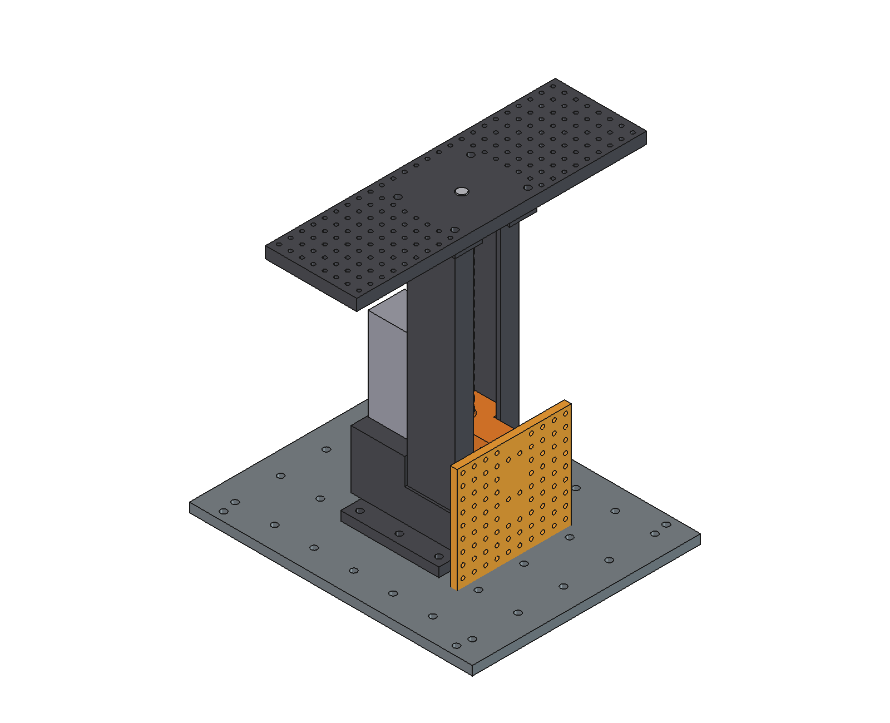

# Elevator assembly

[← Back to README](../README.md#03--lead-screw-elevator)

## Parts and hardware

| Item | Qty | Where |
|---|:-:|---|
| 24 Elevator tower, 25 Top plate (Kinect), 26 Tool plate | 1 each | — |
| 27 Carriage (internal thread) | 1 | — |
| 28 Lead screw (one piece, 215.5 mm) | 1 | over the M8 rod |
| 30 Lead-screw gear (16 mm teeth), 31 Pinion | 1 each | gear chamber |
| 608ZZ bearing | 2 | tower floor + top plate |
| M8 threaded rod, 255 mm | 1 | inside the lead screw |
| M8 nut | 2 | one inside the gear, one on top of the screw |
| M6 nut + M6 nyloc nut | 1 + 1 | above and below the pinion |
| M5 × 20 bolt + nut | 6 | tower → top plate of the chassis |
| M5 × 25 bolt + nut | 4 | top plate (25) → tower lugs |
| M3 × 20 screw | 4 | motor → motor shelf (from below) |
| M3 × 20 screw + nut | 4 | tool plate → carriage tongue |
| JGY370 12 V 40 RPM motor, M6 threaded shaft | 1 | motor shelf |
| Printed tools 23, 32, 33, 34 | — | see the [tools section](../README.md#07--assembly-tools) |

## Steps

0. **Tower on the chassis.** 6 × M5 × 20 from above; hold the nuts below with the nut holder tool (23).
1. **Lower bearing.** Press a 608ZZ into the recess in the floor of the gear chamber.
2. **Motor.** Motor on the shelf with the M6 shaft pointing down through the hole; 4 × M3 × 20 from below (use handle 33).
3. **Pinion (31).** On the motor shaft: plain M6 nut in the upper recess → pinion → nyloc nut below (nylon facing down), tightened with wrench 34. The worm-gear motor locks the shaft, so the pinion cannot be turned by hand. This is normal.
4. **Lead-screw gear (30).** Hex pocket facing **up**. Insert it through the front of the chamber, small boss down, resting **on top of** the bearing (it does not go into it). The wide teeth mesh with the pinion at any height between 2 and 18 mm above the floor.
5. **M8 rod with its nut.** On the bench, thread an M8 nut onto the rod leaving **13.5 mm** of rod below the nut. Lower the rod through the tower: the nut drops into the gear's hex pocket (turn the rod slightly to align it) and the tip enters the lower bearing. Do not turn the rod after this; if it turns, the nut rises and lifts the screw.
6. **Outside the tower: carriage + tool plate + lead screw.** Fix the tool plate (26) to the carriage with 4 × M3 × 20. The screw's hex drive and collar cannot pass through the carriage thread, so insert the **top** end of the screw from the **bottom** face of the carriage and turn it (~25 turns) until the carriage reaches the collar.
7. **Lower the assembly.** From the top of the tower, **over the M8 rod**, with the carriage tongue in the front slot, until the screw's hex drive drops into the gear, on top of the nut.
8. **Top M8 nut.** About 19 mm of rod should remain above the screw. Tighten the nut with a 13 mm wrench while pressing the screw down. The two nuts clamp the screw between them, so rod and screw turn together.
9. **Top plate (25).** Press the second 608ZZ into the recess under the plate. Fit it over the rod tip and onto the four lugs; 4 × M5 × 25 with nuts below the lugs.

## First test

- Apply 12 V for **1–2 s** only: the carriage should go up. If it goes down, swap the motor wires.
- Do not let the carriage hit the ends. Total stroke ≈ 149 mm; in the last ~18 mm at the bottom the tool plate touches the chassis, so the **usable stroke is ≈ 131 mm**.
- Listen for clicking or the motor tilting. If that happens, add spacer nuts on the motor's M3 screws.
- Limit switches or software limits are still pending (see the [roadmap](../README.md#roadmap-and-proposed-improvements)).
