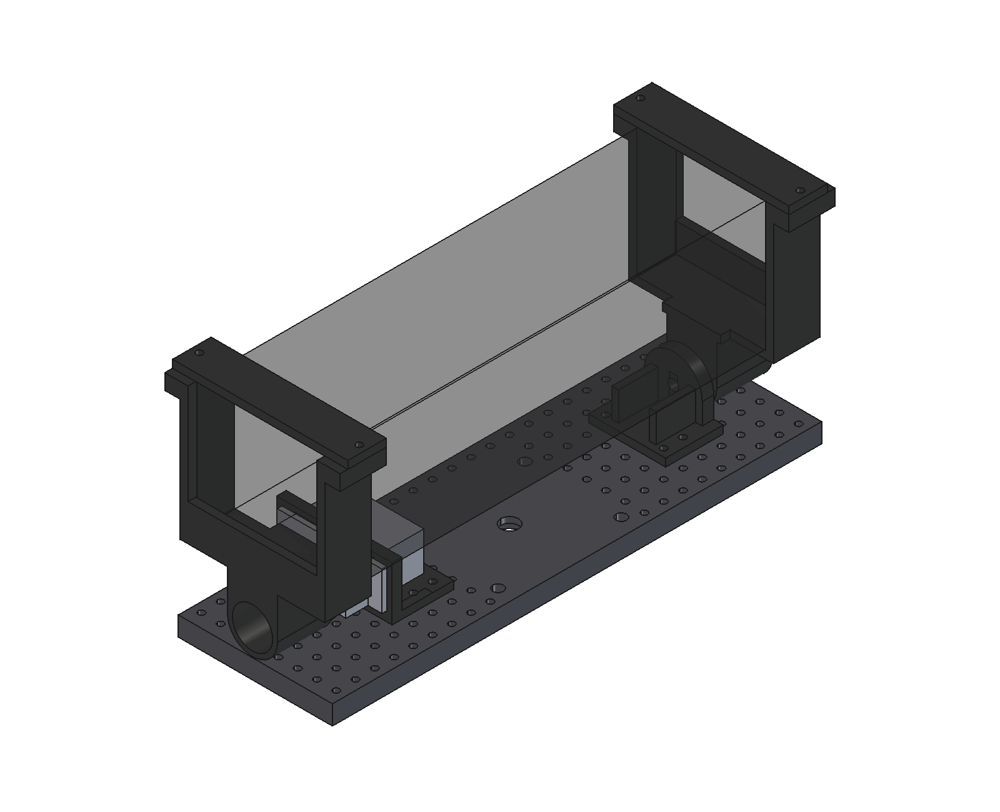

# Kinect v2 tilt mount assembly

[← Back to README](../README.md#04--kinect-v2-tilt-mount)

## Parts and hardware

| Item | Qty | Where |
|---|:-:|---|
| 35a Servo cradle, 35b Pivot cradle, 35d Servo mount, 35e Pivot mount | 1 each | — |
| 35c Clamp bar | 2 | on top of the cradles |
| DS3218MG servo + round horn + kit screws | 1 | 35d |
| M3 × 20 screw + nut | 16 | 4 servo mount, 4 servo tabs, 4 pivot mount, 4 clamp bars |
| M5 × 20 **hex-head** bolt (DIN 933) + **M5 nyloc nut** + M5 washer | 1 | pivot |

## Steps

0. **Centre the servo first** (Arduino: `servo.write(90)`). This position is the level Kinect.
1. **35d on the top plate** (servo end): 4 × M3 × 20 from above, nuts below the plate.
2. **Servo into 35d**: body through the window, shaft towards the end of the plate, tabs against the wall; 4 × M3 × 20 through the tabs with nuts. Route the cable backwards.
3. **35e at the other end**: 4 × M3 × 20, nuts below.
4. **Prepare the cradles (off the robot):**
   - **35a:** place the servo horn against the face of the lug that faces the servo, and drive the kit screws through the round hole at the end (thin screwdriver or handle 33) into the horn.
   - **35b:** push the M5 × 20 **hex-head** bolt through the hex hole at the end until the head bottoms out. The tip comes out through the round hole of the lug. The head is captured and turns with the cradle: it is the pivot pin.
   - Place the Kinect in both cradles (ends against the end stops). Put a clamp bar 35c on each cradle with 2 × M3 × 20 + nuts.
5. **Kinect on the robot:** press the horn onto the servo spline (Kinect level) and tighten the horn screw through the round hole. On the other side, the M5 tip enters the hole in 35e and shows up in the gap between the two ribs. Fit a washer and the **nyloc nut**, tighten it just until it touches the wall, then **back off 1/4 turn** so the Kinect turns freely. Without a nyloc nut, use an M5 × 25 bolt with a nut and a lock nut.

## First test

- Limit the servo in firmware to **−15° to +20°** around the centre (e.g. 75°–110° or 70°–105°, depending on the servo direction; test slowly). Beyond that, the cradle touches the plate.
- Move slowly on the first run: the Kinect weighs about 1 kg.
