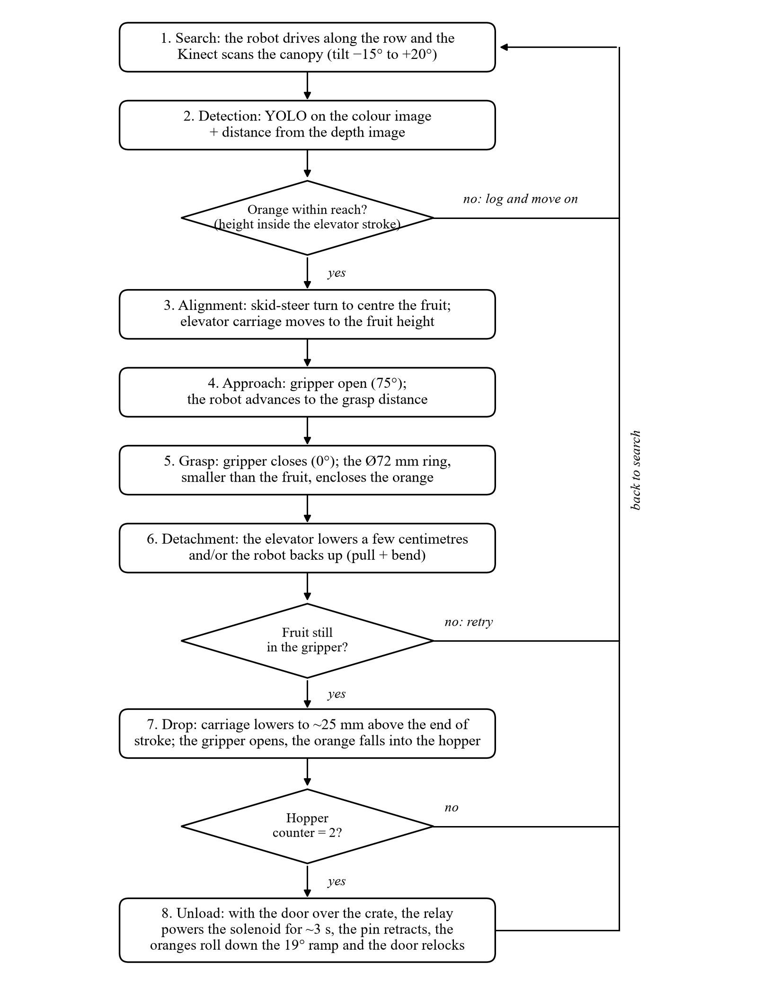

# Hardware and software integration plan

[← Back to README](../README.md#how-the-robot-will-harvest)

This page describes how the components already assembled should be wired and programmed so that the robot runs the full harvesting cycle: find an orange, grasp it, drop it into the hopper and unload the hopper into a crate. **This is a proposal: the software has not been implemented yet.** All distances come from the CAD model and from the limits measured on the prototype.

## Harvesting cycle

The cycle runs as a state machine on the Raspberry Pi.

1. **Search.** The robot drives along the tree row while the Kinect v2 scans the canopy, tilting between −15° and +20°.
2. **Detection.** A YOLO model finds oranges in the colour image. The depth image gives the distance to each one.
3. **Reach check.** If the fruit height is outside the elevator's ~131 mm usable stroke, the fruit is logged for supervision and the search continues.
4. **Alignment.** The robot turns (skid steering) until the fruit is centred in the image. At the same time, the elevator carriage moves to the fruit height.
5. **Approach.** The gripper opens to 75° and the robot moves forward slowly until the fruit is inside the open ring. The stop distance is the measured distance minus the sensor-to-gripper offset.
6. **Grasp.** The gripper closes to 0°. The closed ring (Ø72 mm inside) is smaller than an orange, so the fruit is held by shape, not by squeezing.
7. **Detachment.** The elevator lowers a few centimetres and/or the robot backs up slightly. This pulls and bends the stem.
8. **Check.** A new image confirms the fruit is still in the gripper. If it is not, the robot tries again.
9. **Drop into the hopper.** The carriage lowers to ~25 mm above the end of its stroke, which puts the gripper just above the hopper opening, and the gripper opens. The orange rolls down the ~19° ramp against the door, which the solenoid pin keeps locked. The Arduino counts every drop, because the Kinect cannot see inside the hopper.
10. **Unload.** When the counter reaches two (the hopper capacity), the robot stops with the door over the collecting crate. The door is ~55 mm above the ground, so the crate must be low.
    1. The Arduino powers the solenoid for ~3 s through the relay.
    2. The pin retracts, the weight of the oranges swings the top-hinged door open, and the fruits roll into the crate.
    3. When the solenoid is switched off, the door falls back and the pin relocks it, because the lock is fail-secure.
    4. The counter is reset and the search starts again.

## Fruit recognition and 3D localisation

- **Sensor driver.**
  - [libfreenect2](https://doi.org/10.5281/zenodo.50641) provides the colour and depth images and the registration between them.
  - It requires OpenGL 3.1 for GPU depth processing and does not support OpenGL ES. On the Raspberry Pi 4, depth processing will therefore run on the CPU, at a lower frame rate.
- **Kinect v2 specifications:**
  - colour camera 1920 × 1080 px, depth sensor 512 × 424 px, both at up to 30 Hz;
  - depth field of view 70° × 60°;
  - range 0.5–4.5 m;
  - distance deviations of about 1 cm indoors (Lachat et al., 2015).
- **Detector.**
  - Start from a YOLO model pre-trained on COCO, which already includes the "orange" class.
  - Then fine-tune it with orchard images covering several distances, lighting conditions and leaf occlusion.
  - Liao et al. (2025) reached P 84.4 %, R 73.3 % and mAP 81.6 % for citrus with 1,200 images and a 4.66 MB model.
  - Export the model to **NCNN**, the fastest format on ARM according to the Ultralytics Raspberry Pi guide. The robot stops before each grasp, so a low frame rate is acceptable.
- **3D position.**
  - Take the depth Z as the median of the depth pixels in the central region of the bounding box. This avoids leaves and the fruit's edges.
  - Apply the pinhole model: X = (u − cx)·Z/fx and Y = (v − cy)·Z/fy.
  - The intrinsic parameters come from Zhang's calibration with a printed checkerboard.
- **Camera → robot transform.** The values come from the CAD model:
  - the Kinect optical centre is ~0.42 m above the ground;
  - the gripper ring centre is ~0.13 m ahead of the sensor;
  - the servo tilt angle is applied as a rotation.

  The output is three values the robot can execute: a turn angle, the carriage target height and the forward distance.

## Wiring (proposed)

| Component | Signal | Arduino Mega pin |
|---|---|---|
| Left track H-bridge (BTS7960) | PWM forward / PWM reverse; enable | 2 / 3; 22 and 23 |
| Right track H-bridge (BTS7960) | PWM forward / PWM reverse; enable | 4 / 5; 24 and 25 |
| Elevator H-bridge (BTS7960) | PWM up / PWM down; enable | 6 / 7; 26 and 27 |
| Gripper servo (DS3218MG) | PWM position | 9 |
| Kinect tilt servo (DS3218MG) | PWM position | 10 |
| Solenoid relay module | Digital output | 30 |
| Elevator limit switches | Digital inputs, internal pull-up | 31 (bottom), 32 (top) |
| Raspberry Pi 4 | Serial over USB | USB-B connector |

This uses 8 of the 15 PWM outputs. The power branches stay isolated: 12 V for the H-bridges and the solenoid, 5.0 V for the Pi and the Arduino, 5–6 V for the servos. **All branches share a common ground.**

## Firmware and serial protocol (proposed)

The Raspberry Pi decides what to do; the Arduino executes the movements and enforces the safety limits:

- stop the elevator motor when a limit switch triggers;
- keep the gripper within 0–75° and the Kinect within −15° to +20°;
- stop every motor if no command arrives for a set time (watchdog).

| Command | Example | Action |
|---|---|---|
| `M <left> <right>` | `M 120 -120` | Track speeds (−255 to 255); opposite values turn in place |
| `Z <mm>` | `Z 85` | Move the elevator carriage to a height; replies on arrival or when a limit switch triggers |
| `G <deg>` | `G 75` | Gripper position (0 = closed, 75 = open) |
| `T <deg>` | `T -10` | Kinect tilt (−15 to +20) |
| `D` | `D` | Open the hopper: solenoid on for ~3 s, counter reset |
| `S` | `S` | Report status: carriage height, angles, hopper counter, limit switches |
| `X` | `X` | Emergency stop |

## Supervision and growth

- **Telemetry over MQTT.**
  - MQTT is a lightweight publish/subscribe protocol with three delivery levels (OASIS, 2019).
  - The Pi publishes the robot state, battery voltage, harvested fruits and out-of-reach fruits; a dashboard subscribes to them.
  - Harvest messages should use QoS 1 (at least once), because orchard Wi-Fi is unreliable.
- **Migration to ROS 2.**
  - ROS 2 is built on DDS and organised in topics, services and actions (Macenski et al., 2022).
  - Camera, detector, state machine and Arduino bridge would become independent nodes.
  - Parts such as the detection model can then be replaced without touching the rest.

## References

- Kang, H.; Zhou, H.; Wang, X.; Chen, C. *Real-time fruit recognition and grasping estimation for robotic apple harvesting.* Sensors 20(19):5670, 2020. https://doi.org/10.3390/s20195670
- Lachat, E. et al. *First experiences with Kinect v2 sensor for close range 3D modelling.* ISPRS Archives XL-5/W4, 93–100, 2015. https://doi.org/10.5194/isprsarchives-XL-5-W4-93-2015
- Liao, Y. et al. *YOLO-MECD: citrus detection algorithm based on YOLOv11.* Agronomy 15(3):687, 2025. https://doi.org/10.3390/agronomy15030687
- Macenski, S. et al. *Robot Operating System 2: design, architecture, and uses in the wild.* Science Robotics 7(66), 2022. https://doi.org/10.1126/scirobotics.abm6074
- OASIS. *MQTT version 5.0.* OASIS Standard, 2019. https://docs.oasis-open.org/mqtt/mqtt/v5.0/mqtt-v5.0.pdf
- Ultralytics. *Quick start guide: Raspberry Pi with Ultralytics YOLO.* https://docs.ultralytics.com/guides/raspberry-pi/
- Xiang, L. et al. *libfreenect2: release 0.2.* Zenodo, 2016. https://doi.org/10.5281/zenodo.50641
- Zhang, Z. *A flexible new technique for camera calibration.* Microsoft Research, MSR-TR-98-71, 1998.
